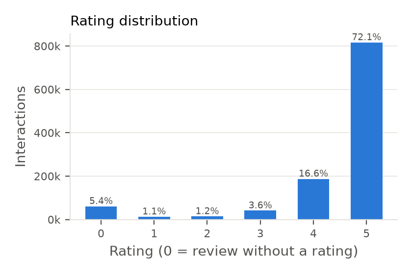
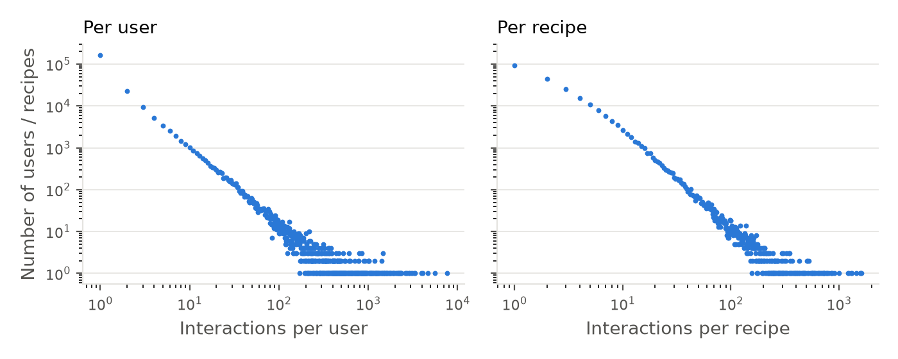
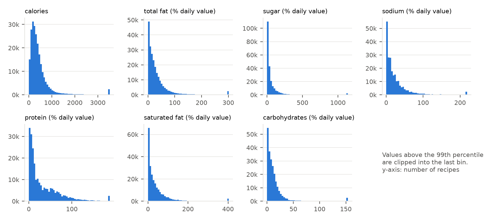
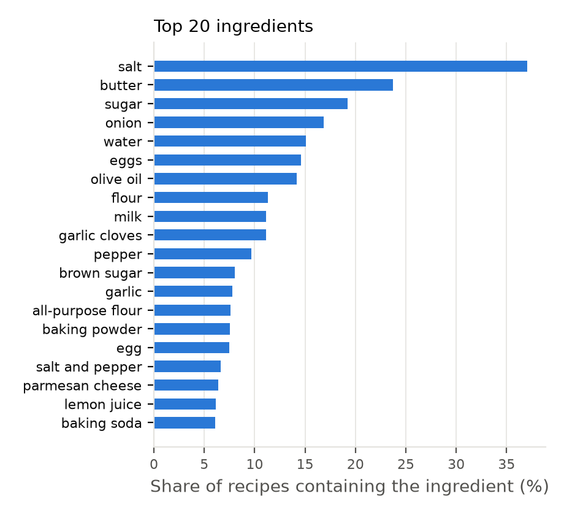
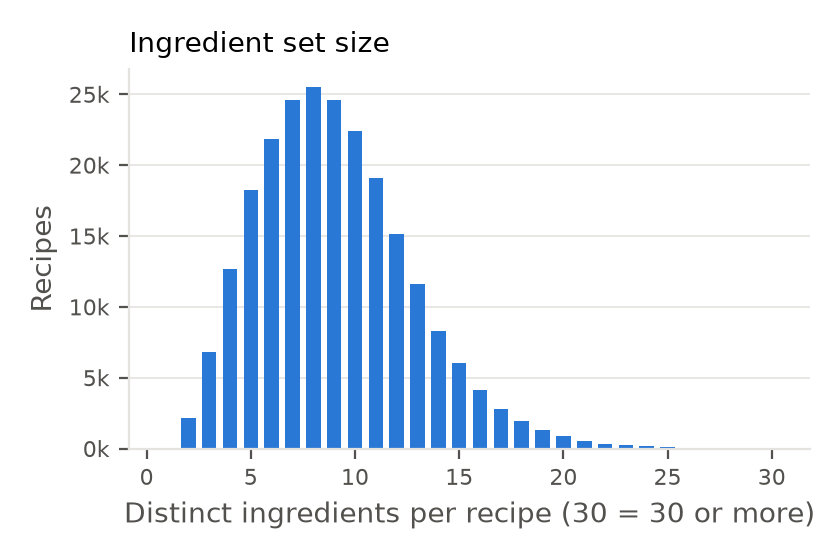

# 탐색적 분석 (EDA)

원본 `RAW_recipes.csv`, `RAW_interactions.csv`를 필터링 없이 집계한 결과다.
모든 수치는 `python3 scripts/eda.py`의 출력이며, 표는 `reports/tables/`, 그림은 `reports/figures/`에 있다.

## 1. 규모와 결측

| 항목 | 값 |
|---|---|
| 레시피 | 231,637 |
| 사용자 | 226,570 |
| 상호작용 | 1,132,367 |
| 날짜 범위 | 2000-01-25 ~ 2018-12-20 |
| 중복 (user, recipe) 쌍 | 0 |

결측은 세 컬럼에만 있다: 레시피 `name` 1건, `description` 4,979건, 상호작용 `review` 169건.
`nutrition`, `ingredients`, `tags`, `rating`, `date`에는 결측이 없다.

## 2. 평점

| 평점 | 건수 | 비율(%) |
|---|---|---|
| 0 | 60,847 | 5.37 |
| 1 | 12,818 | 1.13 |
| 2 | 14,123 | 1.25 |
| 3 | 40,855 | 3.61 |
| 4 | 187,360 | 16.55 |
| 5 | 816,364 | 72.09 |

- 평점 4 이상이 1,003,724건(88.64%)이다. 평점이 5점에 몰려 있어 평점 값 자체의 정보량이 작다.
- 평점 0은 별점 없이 글만 남긴 리뷰다. 리뷰 길이의 중앙값은 195자이고, 내용은 칭찬과 불만이 섞여 있다(무작위 6건을 읽어 확인). 따라서 평점 0을 일괄적으로 긍정이나 부정으로 볼 근거가 없다.

## 3. 사용자·레시피별 상호작용 수

| | 평균 | 중앙값 | 95% | 99% | 최대 | 1건뿐인 비율 | 5건 미만 비율 |
|---|---|---|---|---|---|---|---|
| 사용자당 | 5.00 | 1 | 11 | 61 | 7,671 | 73.4% | 89.8% |
| 레시피당 | 4.89 | 2 | 15 | 47 | 1,613 | 39.7% | 76.9% |

- 분포가 매우 치우쳐 있다. 상위 1% 사용자가 전체 상호작용의 51.2%를 차지한다.
- 원본의 밀도는 0.0022%다.

## 4. k-core 필터링

모든 사용자와 레시피가 k건 이상 남을 때까지 반복해서 걸러낸 결과다. 비율은 원본 1,132,367건 대비다.

| 기준 | k | 상호작용 | 사용자 | 레시피 | 잔존(%) | 밀도(%) |
|---|---|---|---|---|---|---|
| 전체 | 2 | 870,419 | 56,492 | 127,119 | 76.87 | 0.0121 |
| 전체 | 3 | 733,951 | 32,635 | 80,511 | 64.82 | 0.0279 |
| 전체 | 5 | 555,618 | 17,813 | 41,240 | 49.07 | 0.0756 |
| 전체 | 10 | 311,389 | 7,452 | 12,911 | 27.50 | 0.3236 |
| 전체 | 20 | 109,104 | 2,192 | 2,640 | 9.64 | 1.8854 |
| 평점 ≥ 4 | 2 | 782,869 | 48,925 | 117,000 | 69.14 | 0.0137 |
| 평점 ≥ 4 | 3 | 660,839 | 29,013 | 73,992 | 58.36 | 0.0308 |
| 평점 ≥ 4 | 5 | 498,607 | 16,043 | 37,851 | 44.03 | 0.0821 |
| 평점 ≥ 4 | 10 | 273,915 | 6,707 | 11,607 | 24.19 | 0.3519 |
| 평점 ≥ 4 | 20 | 89,719 | 1,881 | 2,252 | 7.92 | 2.1180 |

- 잠정 설정(평점 ≥ 4, k = 5)에서는 사용자의 8.9%(16,043 / 180,310), 레시피의 17.4%(37,851 / 217,565)만 남는다.
- 사용자별 시간순 분할에서 마지막 날짜에 양성이 2건 이상인 사용자가 이 5-core에서 10.4%다. 날짜가 일 단위라서 같은 날 기록의 순서를 정하는 규칙이 필요하다.

## 5. 영양

| 필드 | 평균 | 1% | 25% | 50% | 75% | 95% | 99% | 99.9% | 최대 | 0인 비율(%) |
|---|---|---|---|---|---|---|---|---|---|---|
| calories | 473.9 | 18.4 | 174.4 | 313.4 | 519.7 | 1,268.7 | 3,517.0 | 8,291.0 | 434,360.2 | 0.02 |
| total_fat | 36.1 | 0.0 | 8.0 | 20.0 | 41.0 | 112.0 | 302.0 | 764.7 | 17,183.0 | 7.24 |
| sugar | 84.3 | 0.0 | 9.0 | 25.0 | 68.0 | 269.0 | 1,141.6 | 3,148.7 | 362,729.0 | 4.46 |
| sodium | 30.1 | 0.0 | 5.0 | 14.0 | 33.0 | 90.0 | 219.0 | 1,179.0 | 29,338.0 | 8.57 |
| protein | 34.7 | 0.0 | 7.0 | 18.0 | 51.0 | 107.0 | 188.0 | 462.0 | 6,552.0 | 4.25 |
| saturated_fat | 45.6 | 0.0 | 7.0 | 23.0 | 52.0 | 147.0 | 404.0 | 1,166.0 | 10,395.0 | 8.52 |
| carbohydrates | 15.6 | 0.0 | 4.0 | 9.0 | 16.0 | 43.0 | 154.0 | 356.0 | 36,098.0 | 5.64 |

calories 외 6개는 PDV(%)다.

- 모든 필드가 오른쪽으로 길게 늘어진 분포다. 평균이 중앙값보다 훨씬 크고 최대값은 중앙값의 수백~수천 배다.
- PDV가 100을 크게 넘는 값이 흔하다(sugar의 95%가 269). 원출처가 1회 제공량 기준을 밝히지 않으므로 레시피 전체 분량 기준 값이 섞여 있을 가능성이 있다.
- 7개 필드가 모두 0인 레시피는 없다.

칼로리 이상치 기준 후보별 해당 레시피 수:

| 기준 | 레시피 | 비율(%) |
|---|---|---|
| calories > 1,000 | 16,778 | 7.243 |
| calories > 2,000 | 6,072 | 2.621 |
| calories > 3,000 | 3,151 | 1.360 |
| calories > 5,000 | 1,049 | 0.453 |
| calories > 10,000 | 125 | 0.054 |
| calories > 99% (3,517.0) | 2,317 | 1.000 |
| calories > 99.5% (4,803.1) | 1,159 | 0.500 |
| calories > 99.9% (8,291.0) | 232 | 0.100 |
| calories == 0 | 53 | 0.023 |

필드 사이의 Spearman 상관은 `reports/tables/nutrition_spearman_corr.csv`에 있다.

## 6. 재료

| 항목 | 값 |
|---|---|
| 서로 다른 재료 이름 | 14,942 |
| 레시피당 재료 수 | 평균 9.05, 중앙값 9, 최대 43 |
| 레시피 1개에만 나오는 재료 | 3,546 (23.7%) |
| 레시피 5개 미만에 나오는 재료 | 6,932 (46.4%) |
| 레시피의 1% 이상에 나오는 재료 | 146 |
| 레시피의 10% 이상에 나오는 재료 | 10 |
| 재료가 3개 미만인 레시피 | 2,152 (1개뿐인 레시피 25) |
| 재료 집합이 다른 레시피와 완전히 같은 레시피 | 3,988 (1,723개 묶음) |

- 한 레시피 안에 같은 재료가 두 번 나오는 경우는 없고, `n_ingredients` 컬럼은 실제 재료 수와 모두 일치한다.
- 고빈도 재료가 뚜렷하다. salt는 37.0%, butter는 23.7%의 레시피에 들어 있다. 이런 재료는 거의 모든 쌍의 Jaccard를 조금씩 올린다.
- 같은 재료가 다른 이름으로 적힌 경우가 많다. 상위 30개 안에서만 eggs / egg, garlic cloves / garlic, flour / all-purpose flour, pepper / black pepper / salt and pepper, vanilla / vanilla extract가 보인다. 끝의 s만 다른 이름 쌍은 1,077개다.
- 재료 수가 아주 적은 레시피는 재료 하나 차이로 Jaccard가 크게 바뀐다.

## 7. 태그와 기타

- 태그는 552종이고 레시피당 평균 17.9개다. 태그가 없는 레시피는 없다. 상위 태그는 `reports/tables/top_tags.csv`에 있다.
- `minutes`에는 명백한 오류값이 있다. 최대 2,147,483,647, 0인 레시피 1,094개, 하루(1,440분)를 넘는 레시피 2,000개다. 이 프로젝트의 파이프라인은 `minutes`를 쓰지 않는다.

## 8. 전처리에 주는 시사점

| 관찰 | 전처리에서의 처리 |
|---|---|
| 평점 0은 긍정·부정이 섞인 무평점 리뷰 | 양성에서 제외하되 행은 남겨 "이미 본 레시피"로 쓴다 |
| 사용자의 73.4%가 1건뿐 | k-core 필터링이 필요하다. k에 따른 잔존 규모는 4절의 표 |
| 날짜가 일 단위, 마지막 날 동률 10.4% | 분할의 동률 처리 규칙을 정하고 문서화한다 |
| 영양 값의 극단적 꼬리 | 칼로리 이상치 기준을 5절의 표에서 고른다. 표준화 전에 변환이나 절단이 필요하다 |
| 고빈도 재료와 표기 변형 | MinHash 입력을 만들 때 재료 이름 정규화와 고빈도 재료 처리를 정한다 |
| 재료가 매우 적은 레시피, 동일 재료 집합 | LSH 평가에서 따로 집계한다 |
