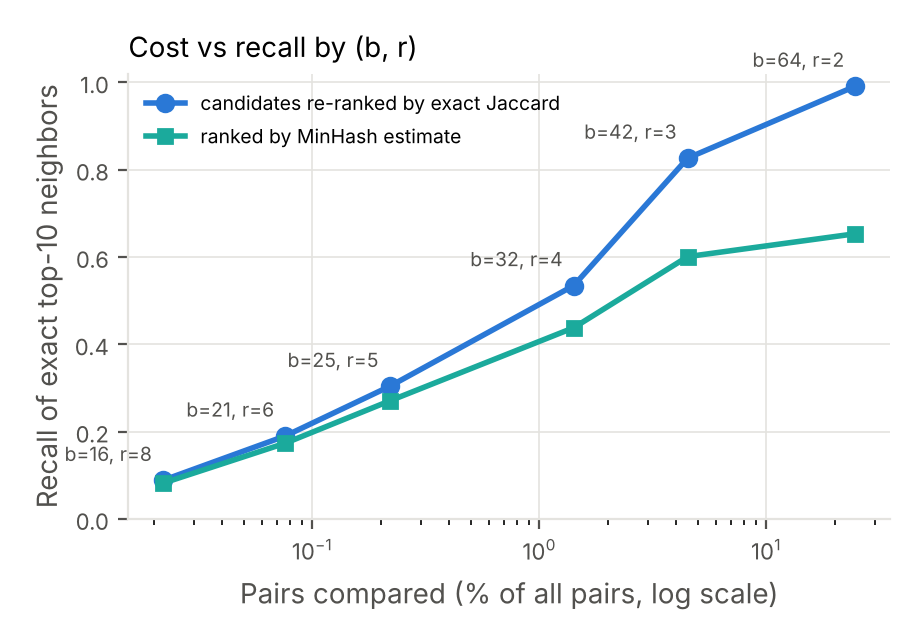
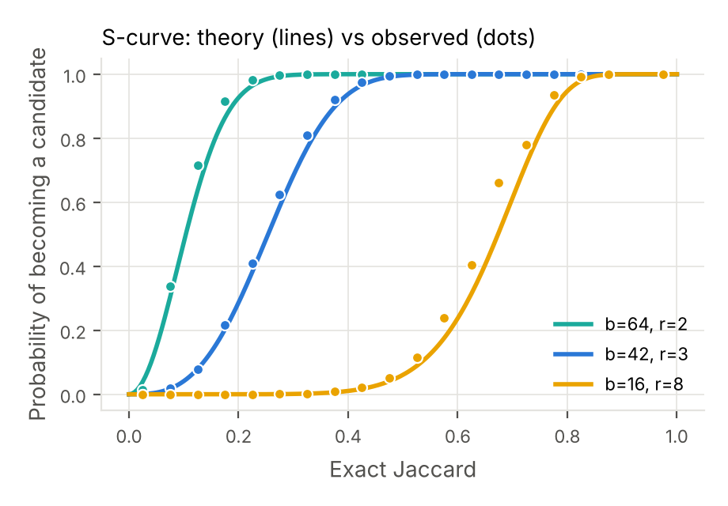

# LSH 평가

LSH가 찾는 후보를 전수 비교로 구한 정확한 Jaccard와 비교한다.
(b, r) 설정에 따른 재현율, 비교량, 조회 시간을 재고 기본 설정을 정한다.
수치는 모두 아래 스크립트의 출력이다. 시간은 Claude 작업 공간(CPU 2코어)에서 잰 값이고 실행마다 조금씩 달라진다.

```bash
python3 scripts/lsh_eval.py       # (b, r) 비교, S-curve, 규모 실험 (약 1분 30초)
python3 scripts/lsh_user_hit.py   # 추천 후보로 썼을 때의 validation 정답 포함률 (약 1분 30초)
```

## 1. 실험 설정

- 대상: 추천 대상 레시피 37,818개. 정규화한 재료 집합, 시그니처 길이 128.
- 질의: 무작위 레시피 2,000개. 질의마다 나머지 모든 레시피와의 정확한 Jaccard를 계산해 기준값으로 쓴다.
- 설정: 시그니처 128개 안에서 만들 수 있는 (b, r) 여섯 가지. r이 커질수록 후보가 되는 문턱이 높아진다.
- 기준 수치: 정확한 상위 10개 이웃의 평균 Jaccard는 0.399다. Jaccard 0.5 이상인 쌍은 질의당 평균 24개, 0.3 이상은 314개다.

지표:
- **상위 10 재현율**: 정확한 상위 10개 이웃 중 LSH 검색 결과의 상위 10개에 든 비율.
- **유사도별 재현율**: 정확한 Jaccard가 기준 이상인 쌍 중 후보가 된 비율.
- **비교한 쌍**: 후보 쌍이 전체 쌍에서 차지하는 비율. 낮을수록 계산이 적다.

## 2. (b, r)에 따른 결과

| b | r | 문턱 | 후보 수(중앙값) | 비교한 쌍 | 후보 없는 질의 | 상위 10 재현율 | J ≥ 0.3 | J ≥ 0.5 | J ≥ 0.7 | 조회(ms) |
|---|---|---|---|---|---|---|---|---|---|---|
| 64 | 2 | 0.13 | 10,078.5 | 24.64% | 0.0% | 0.991 | 1.000 | 1.000 | 1.000 | 2.50 |
| **42** | **3** | 0.29 | 1,032.5 | 4.50% | 0.4% | **0.826** | 0.882 | 0.999 | 1.000 | 0.84 |
| 32 | 4 | 0.42 | 73 | 1.42% | 5.2% | 0.535 | 0.473 | 0.943 | 1.000 | 0.39 |
| 25 | 5 | 0.53 | 8 | 0.22% | 18.7% | 0.304 | 0.203 | 0.753 | 0.998 | 0.22 |
| 21 | 6 | 0.60 | 1 | 0.08% | 39.6% | 0.190 | 0.076 | 0.424 | 0.981 | 0.16 |
| 16 | 8 | 0.71 | 0 | 0.02% | 70.5% | 0.088 | 0.025 | 0.210 | 0.873 | 0.08 |

문턱은 (1/b)^(1/r)이다. 상위 10 재현율과 조회 시간은 후보를 정확한 Jaccard로 다시 정렬한 경우다(3절).
전체 표는 `reports/tables/lsh_configs.csv`에 있다.



- **유사도가 높은 쌍은 적은 비교로 거의 다 찾는다.** b = 32, r = 4는 전체 쌍의 1.4%만 비교하고 Jaccard 0.5 이상인 쌍의 94.3%, 0.6 이상의 99.8%를 찾는다.
- **상위 10개 이웃을 찾는 일은 더 어렵다.** 이 데이터에서 가장 비슷한 이웃의 Jaccard가 0.4 안팎이어서, 이를 놓치지 않으려면 문턱을 0.3 아래로 내려야 하고 그만큼 후보가 늘어난다.
- b = 64, r = 2는 거의 모든 이웃을 찾지만 전체 쌍의 4분의 1을 비교해 전수 비교와 속도 차이가 거의 없다.

## 3. 순위를 무엇으로 매길 것인가

후보를 찾은 뒤 순위를 매기는 방법 두 가지를 비교했다.

| b | r | 상위 10 재현율: 정확한 Jaccard로 정렬 | 상위 10 재현율: MinHash 추정값으로 정렬 |
|---|---|---|---|
| 64 | 2 | 0.991 | 0.653 |
| 42 | 3 | 0.826 | 0.601 |
| 32 | 4 | 0.535 | 0.438 |

- b = 64, r = 2에서는 정확한 상위 10개가 후보에 99.1% 들어 있는데도, 추정값으로 정렬하면 65.3%만 상위 10개에 남는다. 놓치는 원인이 LSH가 아니라 추정 오차다.
- 길이 128인 시그니처의 추정 오차(RMSE 약 0.04)가 이웃들 사이의 Jaccard 차이보다 크기 때문이다.
- 그래서 **LSH는 후보를 줄이는 데만 쓰고, 후보의 순위는 재료 집합으로 계산한 정확한 Jaccard로 매긴다**(`lsh.rank_by: exact`). 후보가 수백~수천 개뿐이라 추가 비용이 작다.

## 4. S-curve

Jaccard가 s인 쌍이 후보가 될 확률의 이론값은 1 − (1 − s^r)^b다.
정확한 Jaccard를 0.05 간격으로 나눠 구간별로 후보가 된 비율을 재고 이론값과 비교했다.



- 관측값은 이론 곡선의 모양을 따른다. 쌍이 1,000개 이상인 구간에서 관측값과 이론값의 차이는 평균 0.022, 최대 0.148이다(`reports/tables/lsh_s_curve.csv`).
- 차이가 큰 곳은 곡선이 가파른 문턱 근처이고, **seed에 따라 달라진다.** b = 42, r = 3에서 Jaccard가 0.2 이상 0.4 미만인 쌍이 후보가 되는 비율을 seed 12개로 재면 0.339에서 0.576까지 퍼진다. 12개의 평균은 0.470(표준오차 0.022)으로 이론값 0.476과 구별되지 않는다(`reports/tables/lsh_s_curve_by_seed.csv`).
- 이유는 MinHash 오차와 같다. 모든 쌍이 같은 해시 함수를 쓰고 흔한 재료를 공유해서, 한 번의 실행 안에서는 쌍들의 결과가 서로 상관된다.
- 따라서 2절의 재현율은 seed 42에서의 값이고, 다른 seed에서는 문턱 근처 구간의 재현율이 몇 %p 달라질 수 있다.

## 5. 속도와 규모

질의 하나의 상위 10개를 구하는 시간을 비교했다(추천 대상 레시피, 질의 500개 평균).

| 방법 | 질의당 시간 |
|---|---|
| 정확한 Jaccard를 모든 레시피와 계산 | 3.2 ms |
| MinHash 시그니처를 모든 레시피와 비교 (LSH 없이) | 5.3 ms |
| LSH (b = 42, r = 3) + 정확한 Jaccard 정렬 | 0.84 ms |
| LSH (b = 32, r = 4) + 정확한 Jaccard 정렬 | 0.39 ms |

- **시그니처만으로는 빨라지지 않는다.** 재료 집합이 평균 9개로 작아서, 길이 128인 시그니처를 비교하는 것이 집합을 직접 비교하는 것보다 오히려 느리다. 이 데이터에서 MinHash의 쓸모는 유사도 추정이 아니라 LSH의 버킷을 만드는 데 있다.
- LSH의 이득은 이 규모에서는 크지 않다. b = 42, r = 3은 전수 비교보다 4~6배 빠르고(실행마다 다르다) 상위 10개의 17%를 놓친다.

레시피 수를 늘리면 이득이 커진다. 전체 레시피 231,352개를 인덱스에 넣고 질의 300개로 쟀다.

| 레시피 수 | b | r | 상위 10 재현율 | LSH 조회(ms) | 전수 비교(ms) | 속도 비 |
|---|---|---|---|---|---|---|
| 37,818 | 42 | 3 | 0.826 | 0.59 | 3.06 | 5.2배 |
| 37,818 | 32 | 4 | 0.544 | 0.34 | 3.06 | 9.0배 |
| 231,352 | 42 | 3 | 0.875 | 2.83 | 25.93 | 9.2배 |
| 231,352 | 32 | 4 | 0.631 | 1.16 | 25.93 | 22.3배 |
| 231,352 | 25 | 5 | 0.395 | 0.47 | 25.93 | 55.3배 |

- 레시피가 6.1배 늘 때 전수 비교 시간은 8.5배 늘었고, 같은 설정의 LSH 조회 시간은 1.7~4.8배 늘었다(`reports/tables/lsh_scale.csv`).
- 레시피가 많아지면 비슷한 이웃이 늘어 상위 10개의 Jaccard가 높아지므로 재현율도 오른다(0.826 → 0.875).
- 인덱스 생성은 전체 레시피에서도 약 2초다.

## 6. 기본 설정

**b = 42, r = 3**(시그니처 126개 사용, 문턱 약 0.29)으로 정했다.

- 이 프로젝트에서 LSH는 레시피마다 재료가 비슷한 레시피 목록을 만드는 데 쓴다. 목록의 질이 속도보다 중요하다.
- b = 42, r = 3은 상위 10개의 82.6%를 찾고 후보가 없는 레시피가 0.4%다. b = 32, r = 4는 53.5%, 5.2%다.
- b = 64, r = 2는 재현율이 99.1%지만 전수 비교와 속도가 거의 같아 LSH를 쓰는 의미가 없다.

이 설정으로 만든 `lsh_neighbors.csv`에서 레시피의 93.6%(35,405개)가 이웃 20개를 다 채웠고, 이웃이 하나도 없는 레시피는 125개(0.3%)다.

## 7. 추천 후보로 쓸 때의 정답 포함률

사용자가 train에서 좋아한 레시피마다 상위 N개 이웃을 모아 추천 후보로 삼고, 그 사용자의 validation 정답이 후보에 들어 있는 비율을 쟀다.
이미 본 레시피는 후보에서 뺐고 test는 쓰지 않았다. 사용자 16,029명 기준이다.

| 좋아한 레시피당 이웃 N | 후보 수(중앙값) | LSH | 정확한 이웃 | 같은 수의 인기순 후보 |
|---|---|---|---|---|
| 5 | 40 | 1.2% | 1.3% | 8.4% |
| 10 | 80 | 1.9% | 2.0% | 11.9% |
| 20 | 160 | 3.1% | 3.3% | 17.0% |
| 50 | 393 | 6.0% | 6.3% | 25.1% |
| 100 | 742 | 9.2% | 10.1% | 32.2% |

- **LSH와 정확한 이웃의 차이는 작다.** LSH가 놓치는 이웃 때문에 잃는 정답은 0.1~0.9%p다.
- **재료 유사 후보는 인기순 후보보다 정답을 훨씬 적게 포함한다.** 후보 160개에서 3.1% 대 17.0%다. 사용자가 다음에 좋아할 레시피는 이전에 좋아한 레시피와 재료가 비슷한 경우가 드물다.
- 따라서 재료 유사 레시피만으로 추천 후보를 한정하면 뒤의 모델이 아무리 좋아도 Recall이 위 수치를 넘을 수 없다.

인기순 후보의 수치가 `docs/minhash.md`의 13.7%와 다른 것은 계산 방식이 달라서다. 거기서는 모든 사용자에게 상위 160개를 똑같이 줬고, 여기서는 사용자마다 LSH 후보와 같은 수를 주고 이미 본 레시피를 뺐다.

**시사점**: 재료 유사도는 취향 예측의 후보 생성보다는 다른 용도에 맞다.
추천된 레시피와 재료는 비슷하면서 영양이 더 나은 대체 레시피를 찾거나, 추천 목록 안에서 서로 너무 비슷한 레시피를 걸러내는 용도다.
어느 쪽으로 연결할지는 팀이 정한다.

## 8. 한계

- 재현율과 S-curve는 seed 하나의 결과다. 문턱 근처에서는 seed에 따라 몇 %p 달라진다(4절).
- 시간은 한 환경에서 잰 값이고 실행마다 달라진다. 구현은 파이썬과 NumPy이며 최적화한 구현과의 비교가 아니다.
- 재료 집합이 작아서(평균 9개) Jaccard 값이 띄엄띄엄하고 이웃 사이의 차이가 작다. 문서 유사도처럼 집합이 큰 문제에서보다 LSH의 이득이 작다.
- 7절은 validation 사용자의 정답 1건만 본 결과다. 재료가 비슷한 레시피를 사용자가 대체재로 받아들이는지는 측정하지 못했다.
