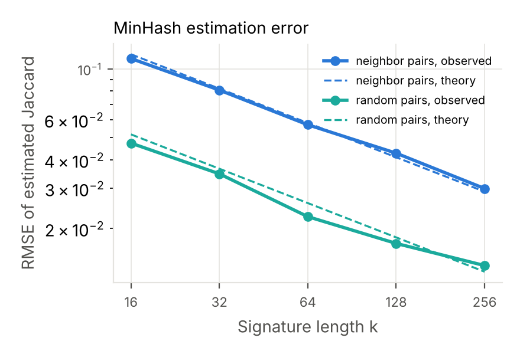
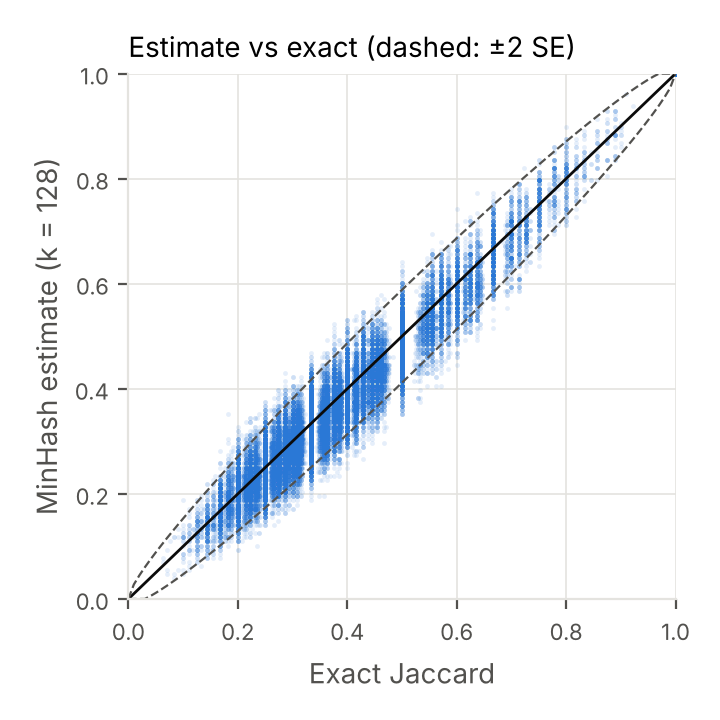

# MinHash: 재료 집합과 시그니처

레시피의 재료 집합 사이의 Jaccard 유사도를 MinHash 시그니처로 추정한다.
이 문서는 재료 집합을 만드는 규칙, 구현, 정확한 Jaccard와 비교한 추정 오차를 적는다.
수치는 모두 아래 스크립트의 출력이다.

```bash
python3 scripts/build_minhash.py         # 재료 집합과 시그니처 생성 (약 10초)
python3 scripts/minhash_eval.py          # 추정 오차 표와 그림 (약 30초)
python3 scripts/ingredient_variants.py   # 재료 집합 만드는 방법 비교 (약 4분)
```

## 1. 입력: 재료 집합

레시피 하나를 재료 이름의 집합으로 본다. 분량과 순서는 쓰지 않는다.
두 레시피 A, B의 유사도는 Jaccard(A, B) = |A ∩ B| / |A ∪ B|다.

원본 이름을 그대로 쓰면 같은 재료가 다른 이름으로 적힌 경우(eggs / egg)에 겹치지 않는 것으로 계산된다.
그래서 세 가지 규칙으로 이름을 정리한다. 설정은 `configs/default.yaml`의 `ingredients`에 있다.

| 순서 | 규칙 | 예 | 적용 범위 |
|---|---|---|---|
| 1 | 공백 정리 | 앞뒤 공백 제거, 연속 공백을 하나로 | 이름 6개 |
| 2 | 복수형 접기 | eggs → egg, potatoes → potato, strawberries → strawberry | 이름 1,175개 |
| 3 | 별칭 | kosher salt → salt, garlic clove → garlic, salt and pepper → salt, pepper | 이름 20개 |

- **복수형 접기**는 끝의 s / es / ies를 떼거나 바꾼 형태가 어휘에 실제로 있을 때만 적용한다. molasses, asparagus처럼 s로 끝나지만 복수형이 아닌 이름은 바뀌지 않는다.
- **별칭**은 빈도 상위 130개 이름을 직접 보고 뜻이 분명히 같은 것만 골랐다. 목록은 설정 파일에 있다. "ground beef"처럼 수식어가 재료의 정체를 바꾸는 경우는 넣지 않았다.
- 규칙은 전체 레시피의 재료 이름만으로 만든다. 상호작용 데이터를 쓰지 않는다.

정규화 결과(칼로리 기준을 통과한 전체 레시피 231,352개):

| 항목 | 정규화 전 | 정규화 후 |
|---|---|---|
| 서로 다른 재료 이름 | 14,927 | 13,731 |
| 레시피당 재료 수(평균) | 9.05 | 9.10 |
| 빈 집합 | 0 | 0 |

재료 수 평균이 조금 늘어난 것은 "salt and pepper"를 두 재료로 나눴기 때문이다.
정규화 후 가장 흔한 재료는 salt(48.1%), pepper(29.1%), butter(27.4%), sugar(23.1%), garlic(23.0%)다.

## 2. 고빈도 재료 처리와 정규화의 효과

salt처럼 거의 모든 레시피에 들어가는 재료는 무관한 레시피 사이의 Jaccard를 조금씩 올린다.
정규화 수준과 고빈도 재료 제거 기준을 바꿔 가며 추천 대상 레시피 37,818개의 재료 집합을 만들고, 전수 비교로 정확한 이웃을 구해 비교했다.

| 방법 | 어휘 | 평균 집합 크기 | 빈 집합 | 재료 3개 미만 | 무작위 쌍 Jaccard | 상위 10 이웃 태그 Jaccard | validation 적중률 |
|---|---|---|---|---|---|---|---|
| 원본 이름 | 7,734 | 8.72 | 0 | 445 | 0.0306 | 0.3145 | 3.26% |
| 복수형 접기 | 7,100 | 8.72 | 0 | 445 | 0.0334 | 0.3163 | 3.31% |
| **복수형 + 별칭 (채택)** | 7,080 | 8.78 | 0 | 442 | 0.0496 | 0.3201 | 3.33% |
| + 20% 이상 재료 제거 (7개) | 7,073 | 6.82 | 6 | 1,403 | 0.0173 | 0.3179 | 3.42% |
| + 10% 이상 재료 제거 (12개) | 7,068 | 6.10 | 76 | 2,935 | 0.0096 | 0.3161 | 3.34% |
| + 5% 이상 재료 제거 (22개) | 7,058 | 5.42 | 195 | 4,901 | 0.0061 | 0.3122 | 3.31% |

지표의 뜻:
- **무작위 쌍 Jaccard**: 무작위로 뽑은 레시피 쌍 약 20만 개의 평균. 낮을수록 무관한 레시피가 덜 닮아 보인다.
- **상위 10 이웃 태그 Jaccard**: 재료가 가장 비슷한 10개 레시피와 태그가 얼마나 겹치는가. 재료 유사도가 실제 음식 종류의 유사도를 반영하는지 보는 간접 지표다.
- **validation 적중률**: 사용자가 train에서 좋아한 레시피마다 상위 20개 이웃을 모아 후보로 삼았을 때(사용자당 후보 수 중앙값 160개), 그 사용자의 validation 정답이 후보 안에 있는 비율. test는 쓰지 않았다.

20% 기준에서 빠지는 재료는 butter, egg, garlic, onion, pepper, salt, sugar다.

**관찰**
- 방법 사이의 차이가 작다. 태그 Jaccard는 0.312~0.320, 적중률은 3.26~3.42%다. 적중률의 표준오차가 약 0.14%p(사용자 16,029명)이므로 적중률 차이는 오차 범위 안이다.
- 고빈도 재료를 빼면 무작위 쌍의 유사도는 확실히 내려가지만(0.050 → 0.017), 이웃의 질은 좋아지지 않는다. 기준을 낮출수록 재료가 3개 미만인 레시피와 빈 집합이 늘어난다.

**결정**: 복수형 접기와 별칭을 적용하고, 고빈도 재료는 제거하지 않는다(`max_doc_freq: null`).
제거해도 이웃의 질이 나아진다는 근거가 없고, butter나 egg 같은 실제 재료 정보를 잃으며 빈 집합이 생기기 때문이다.
제거 기준은 설정으로 남겨 두었으므로 값을 바꿔 다시 만들 수 있다.

**함께 드러난 점**: 재료가 비슷한 레시피만 후보로 삼으면 validation 정답을 3.3% 정도만 포함한다.
같은 수(160개)의 후보를 train 인기순으로 뽑으면 13.7%다.
즉 사용자가 다음에 좋아할 레시피는 이전에 좋아한 레시피와 재료가 비슷한 경우가 드물다.
재료 유사 후보를 추천 파이프라인에 어떻게 연결할지는 이 결과를 보고 정해야 한다. 후보 수를 바꿨을 때의 변화는 LSH 평가에서 다룬다.

## 3. MinHash 구현

`src/dmrec/minhash.py`에 직접 구현했다. 외부 MinHash 라이브러리를 쓰지 않는다.

1. 재료 이름을 정수로 바꾼다. BLAKE2b 해시의 8바이트를 정수로 읽어 p = 2³¹ − 1로 나눈 나머지를 쓴다. 파이썬 내장 `hash`와 달리 실행마다 같은 값이 나온다.
2. 해시 함수 k개를 h_i(x) = (a_i · x + b_i) mod p로 둔다. a_i는 1 이상 p 미만, b_i는 0 이상 p 미만에서 seed로 고정한 난수로 뽑는다.
3. 집합 S의 시그니처의 i번째 값은 min over x ∈ S of h_i(x)다.
4. 두 시그니처에서 같은 위치의 값이 일치하는 비율이 Jaccard의 추정값이다.

- p를 2³¹ − 1로 둔 이유: a와 x가 모두 p 미만이므로 a · x < 2⁶²이고, 64비트 부호 없는 정수 안에서 넘치지 않는다.
- 전체 레시피의 시그니처는 한 번에 계산한다. 해시 함수 하나마다 모든 (레시피, 재료) 원소의 해시값을 벡터 연산으로 구하고 레시피별 최솟값을 취한다.
- 빈 집합의 시그니처는 실제 해시값이 될 수 없는 값(p)으로 채우고, 빈 집합이 낀 쌍의 추정값은 0으로 둔다. 기본 설정에서는 빈 집합이 없다.
- 근거: Leskovec, Rajaraman, Ullman, *Mining of Massive Datasets*, 3장 [1].

산출물은 `data/processed/`의 `ingredient_sets.csv`와 `minhash_signatures.npz`다. 형식은 `docs/data_schema.md`에 있다.

## 4. 추정 오차

추천 대상 레시피에서 두 종류의 쌍을 뽑아 정확한 Jaccard와 비교했다.
- 무작위 쌍 99,999개: 평균 Jaccard 0.050
- 이웃 쌍 40,000개: 무작위 레시피 2,000개의 정확한 상위 20개 이웃. 평균 Jaccard 0.374

추정값의 표준오차는 이론적으로 sqrt(J(1 − J) / k)다.



| 쌍 | k | 평균 오차 | MAE | RMSE | 이론 RMSE | 최대 절대 오차 |
|---|---|---|---|---|---|---|
| 이웃 | 16 | −0.0018 | 0.0885 | 0.1112 | 0.1160 | 0.500 |
| 이웃 | 32 | −0.0163 | 0.0645 | 0.0808 | 0.0821 | 0.375 |
| 이웃 | 64 | −0.0140 | 0.0456 | 0.0570 | 0.0580 | 0.229 |
| 이웃 | **128** | −0.0106 | 0.0342 | 0.0428 | 0.0410 | 0.170 |
| 이웃 | 256 | −0.0059 | 0.0239 | 0.0299 | 0.0290 | 0.117 |
| 무작위 | 128 | −0.0042 | 0.0094 | 0.0172 | 0.0183 | 0.134 |

- RMSE는 이론값과 거의 같고, k를 4배로 늘리면 절반으로 줄어든다.
- k = 128에서 이웃 쌍의 94.65%가 정확값 ± 2 표준오차 안에 있다(정규 근사에서 기대되는 값은 약 95%).



**평균 오차가 음수인 것은 추정이 치우쳤기 때문이 아니다.**
위 표의 평균 오차는 seed 42 한 번의 결과다. 모든 쌍이 같은 해시 함수 128개를 쓰고 salt 같은 흔한 재료를 공유하므로, 한 번의 실행 안에서는 쌍들의 오차가 같은 방향으로 움직인다.
seed를 0~19로 바꿔 k = 128에서 다시 재면 seed별 평균 오차는 −0.018에서 +0.011 사이에 퍼지고, 20개의 평균은 −0.0006(표준오차 0.0017)이다. 0과 구별되지 않는다.

Jaccard 구간별 오차(k = 128, 이웃 쌍)는 `reports/tables/minhash_error_by_jaccard.csv`에 있다. 오차는 J가 0.5~0.7인 구간에서 가장 크고(RMSE 최대 0.049) 양 끝에서 작다.

**시그니처 길이**: k = 128을 기본으로 둔다. 이웃 쌍의 RMSE가 0.043이다. LSH의 band 수와 row 수를 정할 때 다시 검토한다.

## 5. 계산 시간

Claude 작업 공간(CPU 2코어)에서 잰 값이다. 환경에 따라 달라진다.

| 대상 | 레시피 | 원소 수 | k = 64 | k = 128 | k = 256 |
|---|---|---|---|---|---|
| 추천 대상 | 37,818 | 332,167 | 0.21초 | 0.39초 | 0.71초 |
| 전체 | 231,352 | 2,106,039 | 1.54초 | 3.09초 | 5.93초 |

시간은 원소 수와 k에 비례한다.
참고로 추천 대상 레시피의 모든 쌍을 정확히 비교해 상위 20개 이웃을 구하고 지표를 계산하는 데는 같은 환경에서 방법당 33~41초가 걸렸다(`reports/tables/ingredient_variants.csv`의 `seconds`). 레시피 수의 제곱에 비례하므로 전체 레시피에서는 훨씬 오래 걸린다.

## 6. 검증

- 단위 테스트(`tests/test_minhash.py`, `test_ingredients.py`, `test_jaccard.py`) 16개(그중 1개는 아래의 라이브러리 비교): 같은 seed의 재현성, 순서와 중복에 무관함, 같은 집합의 추정값 1, 겹치지 않는 집합의 추정값 0 근처, 빈 집합 처리, 일괄 계산과 개별 계산의 일치, 겹침을 0~10으로 바꾼 합성 집합에서 평균 추정값이 정확값의 4 표준오차 안에 있음.
- 정확한 이웃 탐색은 집합 정의대로 계산한 전수 비교 결과와 일치하는지 테스트한다.
- 검증용 라이브러리 `datasketch`와 오차 수준을 비교하는 테스트가 있다. 설치되어 있지 않으면 건너뛴다(`pip install -r requirements-dev.txt` 후 실행).

## 7. 한계

- 재료의 분량과 조리법을 보지 않는다. 재료 목록이 같으면 전혀 다른 음식이어도 유사도가 1이다.
- 별칭 20개는 상위 130개 이름에서만 골랐다. 드문 재료의 표기 변형은 남아 있다.
- 재료가 3개 미만인 레시피(추천 대상 중 442개)는 재료 하나 차이로 Jaccard가 크게 바뀐다.
- 태그 Jaccard는 간접 지표다. 재료가 비슷한 레시피를 사용자가 실제로 대체재로 받아들이는지는 측정하지 못했다.

## 참고 문헌

[1] J. Leskovec, A. Rajaraman, and J. D. Ullman, *Mining of Massive Datasets*, 3rd ed. Cambridge University Press, 2020, ch. 3.
